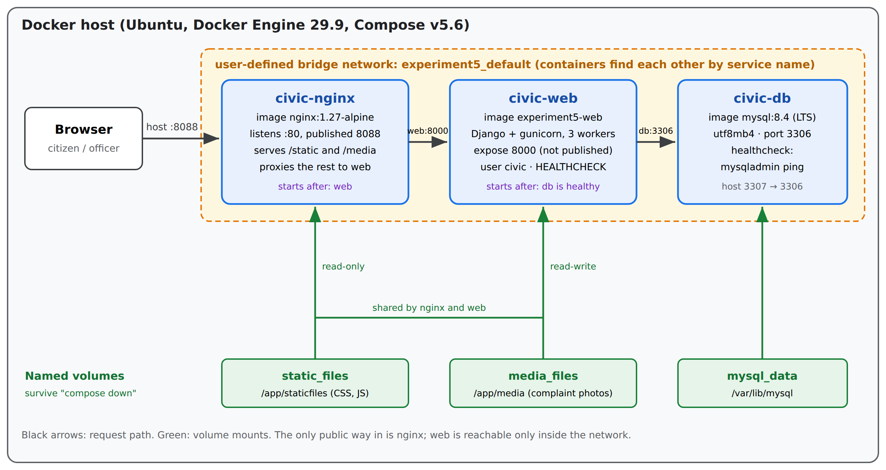
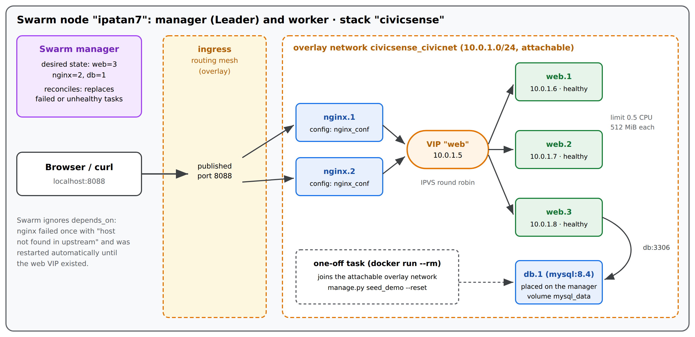

# CivicSense on Docker

CivicSense is a civic complaint platform built with Django and MySQL. Citizens report problems like potholes, overflowing garbage or broken street lights in plain language, and a small NLP engine routes each complaint to the right department, merges repeat reports of the same problem and ranks everything by priority for the officers who have to fix it.

This repository is about running that application properly with Docker: a two-stage image, a three-container Compose stack, a Docker Swarm stack with replicas and rolling updates, and a CI pipeline that tests the code against a real MySQL database before it builds an image.

It is my project for **Containerization With Docker (25CAH-734)**, MCA Cloud Computing & DevOps, Chandigarh University (class group 25CAH-734:P::GP-A, guided by Sofia). The full project report is in [`report/`](report/).



## What's inside

| Path | What it is |
|---|---|
| `Dockerfile` | Two-stage build. The compiler needed for `mysqlclient` stays in the builder stage; the shipped image runs as a non-root user and has its own `HEALTHCHECK`. |
| `docker/entrypoint.sh` | Waits for MySQL, runs migrations, collects static files, then hands over to gunicorn with `exec`. |
| `docker/nginx.conf` | Reverse proxy in front of gunicorn; serves static files and uploaded photos straight from volumes. |
| `docker-compose.yml` | MySQL 8.4 + Django/gunicorn + nginx, health-gated start-up, named volumes. |
| `docker-compose.demo.yml` | Small override that moves the portal to port 8088 if 8080 is already taken. |
| `docker-stack.yml` | The same system on Docker Swarm: 3 web replicas, 2 nginx replicas, overlay network, rolling updates with rollback. |
| `.github/workflows/ci.yml` | Tests on a MySQL service container, then builds the image and checks `/healthz`. |
| `deploy/k8s/` | Kubernetes Deployment, Service, HPA, migration Job, ConfigMap and Secret template. |
| `civicsense/`, `accounts/`, `complaints/`, `dashboard/`, `nlpengine/` | The Django project and the NLP engine. |
| `report/` | Project report (full and short versions) and a one-page case study. |

## Running it

You only need Docker with the Compose plugin.

```bash
git clone https://github.com/iPatan7/civicsense-docker.git
cd civicsense-docker

docker compose up -d --build      # first build takes about 3 minutes
docker compose ps                 # wait until web shows (healthy)

# load the demo data once (120 complaints, 20 users)
docker compose exec web python manage.py seed_demo --reset
```

Then open http://localhost:8080.

If something else is already using port 8080 (Jenkins, in my case), use the override file and open http://localhost:8088 instead:

```bash
docker compose -f docker-compose.yml -f docker-compose.demo.yml up -d --build
```

Demo accounts:

| Username | Password | Role |
|---|---|---|
| `admin` | `admin123` | administrator, dashboard and `/admin/` |
| `officer` | `civic123` | ward officer |
| `staff_roads` | `civic123` | department staff (roads only) |
| `citizen1` | `civic123` | citizen |

These are throwaway demo credentials. For anything real, set `DJANGO_SECRET_KEY` and the database passwords through environment variables.

## A few things worth trying

```bash
docker compose logs web | head -30                    # wait for MySQL, migrate, start gunicorn
docker inspect -f '{{.State.Health.Status}}' civic-web
docker exec civic-web id                              # uid=1000(civic), not root
docker exec civic-web getent hosts db                 # containers find each other by name
docker stats --no-stream

# run the 39 tests inside the container against MySQL
docker exec -e DB_USER=root -e DB_PASSWORD=rootpass civic-web python manage.py test

# crash the app and watch Docker bring it back
sudo kill -9 $(docker inspect -f '{{.State.Pid}}' civic-web)
watch -n1 docker ps
```

### Docker Swarm

```bash
docker compose down                                   # keeps the volumes
docker swarm init                                     # add --advertise-addr <ip> if asked
docker stack deploy -c docker-stack.yml civicsense    # portal on http://localhost:8088

docker service ls
docker service scale civicsense_web=5
docker service update --env-add DJANGO_LOG_LEVEL=WARNING civicsense_web   # rolling update
docker service rollback civicsense_web

docker stack rm civicsense && docker swarm leave --force
```



## What I measured

All on my laptop (Ubuntu, Docker 29.9, Compose v5.6) on 30 October 2026:

| Test | Result |
|---|---|
| Image size | 435 MB (the builder stage alone is 698 MB) |
| Cold start to healthy / warm start | 74 s / 18 s |
| Tests inside the container on MySQL 8.4 | 39 of 39 passed |
| Web container killed with SIGKILL | restarted in 1.1 s, healthy again in 11.3 s |
| Load balancing over 3 swarm replicas | 90 requests split 30 / 30 / 30 |
| Scaling 3 → 5 replicas | all healthy in 44 s |
| Replica killed while serving traffic | replaced in 15.9 s, 522 requests OK, 0 failed |
| Rolling update / rollback under traffic | 840 OK / 622 OK, 0 failed |

## Things that broke along the way

Running the app the way it's actually deployed turned up problems that never show up with `manage.py runserver`:

- **Django 6 needs MySQL 8.4.** The first Compose file used `mysql:8.0` and the app refused to start.
- **The health check went through nginx without the `Host` header,** so Django answered 400 and a working container was reported unhealthy.
- **Demo data was seeded on every start.** After an automatic restart the database had 240 complaints instead of 120. Seeding is now a one-off command.
- **Every login failed with a CSRF error behind nginx.** The browser sends `Origin: http://localhost:8080`, but the trusted origins didn't include the port. They do now.

The report goes into each of these in more detail.

## Report

- [Project report, full version](report/Project%20report%20CivicSense%20(full).pdf)
- [Project report, short version](report/Project%20report%20CivicSense%20(short).pdf)
- [One-page case study](report/Case%20study%20CivicSense.pdf)

## Author

Mohammad Iqbal Patan (24MCC20081), MCA Cloud Computing & DevOps, University Institute of Computing, Chandigarh University.
